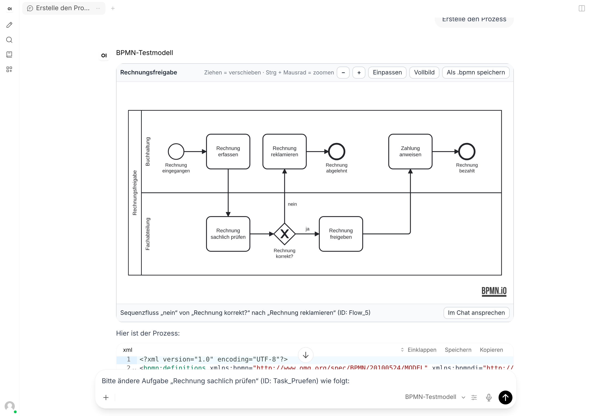

# BPMN-Helper

Hilfsmittel rund um das Open-WebUI-Modell, das aus einer Prozessbeschreibung eine BPMN-Datei für BIC Process Design erzeugt.

Aufgebaut nach der Vorlage [openwebui-extensions-template](https://github.com/T3chSynergy/openwebui-extensions-template). Das Repo ist die Quelle; `scripts/deploy.py` spielt alles in Open WebUI ein.

| Datei | Art | Zweck |
| --- | --- | --- |
| [`functions/actions/bpmn_vorschau.py`](functions/actions/bpmn_vorschau.py) | Aktion | Button, der das BPMN einer Antwort direkt im Chat als Diagramm zeigt |
| [`tools/validate_bpmn_xml.py`](tools/validate_bpmn_xml.py) | Tool | prüft das BPMN des Modells und stellt es auf Wunsch als Datei bereit |
| [`models/bic-bpmn-assistent-v2/`](models/bic-bpmn-assistent-v2/) | Modell | Konfiguration und System-Prompt des BPMN-Assistenten |
| [`functions/pipes/echo.py`](functions/pipes/echo.py) | Pipe | Testmodell ohne Sprachmodell, für den End-to-End-Test und zur Fehlersuche |
| [`vendor/bpmn-js/`](vendor/bpmn-js/README.md) | Bibliothek | Anzeige-Bibliothek zum internen Hosten |
| [`samples/`](samples/) | Beispiele | BPMN-Dateien für Tests |

## Einrichtung

Einmalig `.env.example` nach `.env` kopieren und eintragen:

- `OWUI_URL`: Adresse von Open WebUI
- `OWUI_API_KEY`: API-Key eines Admin-Kontos (Einstellungen → Konto → API-Schlüssel)
- `BPMN_BASISMODELL`: ID des Modells, auf dem der Assistent läuft

Dann zuerst ansehen, was sich ändern würde:

```bash
uv run python scripts/deploy.py --dry-run
```

und einspielen:

```bash
uv run python scripts/deploy.py
```

Das Skript legt Tool, Aktion, die Pipe `echo` und das Modell an oder aktualisiert sie. Valves und Freigaben bestehender Einträge bleiben unverändert. Neue Einträge, etwa die Pipe `echo`, sehen zunächst nur Admins.

**Vor dem ersten Einspielen** den aktuellen Stand aus Open WebUI holen und vergleichen, damit nichts verloren geht, was dort seit dem letzten Export geändert wurde:

```bash
uv run python scripts/export.py
```

```bash
git diff
```

Wurde etwas direkt in Open WebUI geändert, holt `scripts/export.py` es ebenso ins Repo zurück. Details zu beiden Skripten stehen in der README der Vorlage.

## BPMN-Vorschau für Open WebUI



Unter jeder Antwort des Modells erscheint ein Button „BPMN-Vorschau". Ein Klick zeigt das BPMN aus dieser Antwort als Diagramm über dem Antworttext.

- **Verschieben und Zoomen:** Ziehen verschiebt, Strg + Mausrad zoomt, „Vollbild" nutzt den ganzen Bildschirm.
- **Element ansprechen:** Ein Klick auf ein Element zeigt Typ, Name und ID. „Im Chat ansprechen" schreibt den Bezug ins Eingabefeld, zum Beispiel `Bitte ändere Aufgabe „Rechnung sachlich prüfen“ (ID: Task_Pruefen) wie folgt:`.
- **Fehler zurückgeben:** Lässt sich das BPMN nicht oder nur mit Hinweisen einlesen, stehen die Meldungen unter dem Diagramm. Ein Button übergibt sie dem Modell zur Korrektur.
- **Speichern:** „Als .bpmn speichern" lädt exakt den Text herunter, den das Modell geliefert hat. Die Vorschau verändert das BPMN nicht.
- **Verlauf:** Die Vorschau wird mit der Nachricht gespeichert. Jede Antwort hat ihre eigene Vorschau, ältere Stände bleiben also im Chat sichtbar.

Die Funktion sucht in der angeklickten Antwort das letzte vollständige `<definitions>…</definitions>`, mit oder ohne Codeblock und Namensraum-Präfix.

### bpmn-js bereitstellen

Die Anzeige nutzt [bpmn-js](https://bpmn.io/toolkit/bpmn-js/), getestet mit Version 18.33.0. Woher die Bibliothek kommt, steuern die Einstellungen (Valves) der Funktion:

| Variante | Einstellung | Voraussetzung |
| --- | --- | --- |
| Öffentliches CDN (Standard) | nichts ändern | Die Browser der Anwender erreichen `unpkg.com`. |
| Interner Webserver | `bpmn_js_url` auf die interne Adresse setzen | Die Datei liegt auf einem Server, den die Browser erreichen. |
| Einbetten | `bpmn_js_inline` einschalten; `bpmn_js_url` ist eine Adresse oder ein Dateipfad, den der Open-WebUI-Server lesen kann | keine Anforderung an die Browser |

Beim Einbetten wächst jede gespeicherte Vorschau um etwa 200 KB. Für den Dauerbetrieb ist der interne Webserver die bessere Wahl.

Die benötigte Datei liegt im Repo unter [`vendor/bpmn-js/18.33.0/`](vendor/bpmn-js/README.md), zusammen mit Lizenz und Prüfsumme. Für den internen Webserver diese Datei dort ablegen, zum Beispiel unter `https://intranet.example/static/bpmn-js/18.33.0/bpmn-navigated-viewer.production.min.js`, und die Adresse in `bpmn_js_url` eintragen. Die Versionsnummer im Pfad sorgt dafür, dass Browser nach einem Update nicht die alte Datei aus dem Cache nehmen.

Zum Einbetten kann `bpmn_js_url` auch auf diese Datei im Dateisystem des Open-WebUI-Servers zeigen, etwa wenn das Repo dort ausgecheckt oder die Datei in den Container gemountet ist.

Die Höhe der Diagrammfläche stellt `height` ein (Standard 480 Pixel).

### Getestet und nicht getestet

- **Getestet:** Open WebUI 0.13.3 in einer lokalen Installation mit Chromium und dem Beispiel aus [`samples/`](samples/rechnungsfreigabe.bpmn): Anzeige, Fehlerfälle, Speichern, „Im Chat ansprechen", Vollbild und Neuladen des Chats. bpmn-js kam dabei von einem lokalen Webserver und per Einbetten; das öffentliche CDN war in der Testumgebung nicht erreichbar.
- **Nicht getestet:** der Import der gespeicherten Datei in BIC.

### Grenzen

- bpmn-js zeichnet Standard-BPMN 2.0. BIC-eigene Erweiterungen in der Datei werden nicht dargestellt, bleiben aber erhalten. Das Bild kann deshalb im Detail von der Darstellung in BIC abweichen.
- Das BPMN braucht Layout-Angaben (`BPMNDiagram`). Fehlen sie, meldet die Vorschau das, statt ein leeres Bild zu zeigen.
- Hat die Administration `IFRAME_CSP` gesetzt, muss diese Richtlinie das Laden von bpmn-js erlauben.
- Das bpmn.io-Logo im Diagramm muss laut Lizenz von bpmn-js sichtbar bleiben.

## Prüf-Tool `validate_bpmn_xml`

Das Modell ruft das Tool vor jeder XML-Ausgabe auf (siehe System-Prompt, Abschnitt 7). Name, Parameter und Rückgabefelder sind dieselben wie in Version 0.2.0; neu sind die festen Prüfungen nach der XML-Syntax.

**Fehler** (`errors`, das Dokument gilt als ungültig, es wird keine Datei erstellt):

- doppelte IDs, fehlender `targetNamespace`
- Referenzen, die ins Leere zeigen: `sourceRef`, `targetRef`, `processRef`, `messageRef`, `default`, `flowNodeRef`, `bpmnElement`
- `incoming`/`outgoing`, die nicht zu den Sequenzflüssen passen, oder Nachrichtenflüsse darin
- falsche Reihenfolge von `incoming`, `outgoing` und Ereignisdefinitionen
- Startereignis mit eingehendem, Endereignis mit ausgehendem Fluss, Prozess ohne Start
- Sequenzfluss zwischen Pools, Nachrichtenfluss innerhalb eines Pools, Prozess ohne Pool
- BPMN-DI: fehlendes Diagramm, fehlende Shapes oder Edges, ungültige Bounds, weniger als zwei waypoints, Element außerhalb seines Pools, BPMNPlane verweist nicht auf die Kollaboration

**Hinweise** (`warnings`, das Dokument bleibt gültig):

- Elemente außerhalb des Basisprofils, z. B. Lanes oder parallele Gateways (nur nach Freigabe erlaubt), Hersteller-Erweiterungen
- IDs mit Umlauten oder Leerzeichen, `isExecutable` nicht `false`
- Sackgassen, nicht erreichbare Elemente, unbeschriftete Entscheidungen und Pfade
- überlappende Elemente, Linien, die nicht am Elementrand beginnen oder enden oder durch fremde Elemente laufen
- Nachrichtenfluss mit eigenem Namen und zusätzlich benannter Nachricht (doppelte Beschriftung in der Vorschau)

Je Liste werden höchstens 40 Einträge gemeldet. XSD-Konformität, fachliche Richtigkeit und der BIC-Import werden nicht geprüft.

Die Tool-ID `validate_bpmn_xml` nicht ändern: Das Modell und der System-Prompt verweisen darauf.

## Modell `bic-bpmn-assistent-v2`

[`model.json`](models/bic-bpmn-assistent-v2/model.json) enthält Fähigkeiten, eingebaute Tools, die Zuordnung von Tool und Aktion sowie die Reasoning-Stufe. Das Basismodell kommt aus `BPMN_BASISMODELL`, damit die Datei für jede Instanz passt.

[`system-prompt.md`](models/bic-bpmn-assistent-v2/system-prompt.md) ist der System-Prompt mit allgemeinem Referenzmodell (Reklamationsbearbeitung). Die Abschnitte zur Prüfung beschreiben, was das Tool prüft und wie das Modell mit `errors` und `warnings` umgeht.

## Beispiele

| Datei | Inhalt |
| --- | --- |
| `samples/reklamationsbearbeitung.bpmn` | Referenzmodell aus dem System-Prompt: interner Pool, Black-Box-Pool, Nachrichtenflüsse, Sendeaufgaben, Nachrichtenereignisse, Rücksprünge. Das Prüf-Tool meldet dafür weder Fehler noch Hinweise. Nicht in BIC importgeprüft. |
| `samples/rechnungsfreigabe.bpmn` | Einfaches Beispiel mit Lanes. Lanes sind im Basisprofil nur nach Freigabe erlaubt. |

## Tests

```bash
uv run python scripts/check.py
```

```bash
uv run pytest
```

End-to-End gegen eine frische Open-WebUI-Instanz in Docker (nie gegen die produktive Instanz):

```bash
e2e/run.sh
```

Der Test spielt alles ein und prüft, dass Einspielen wiederholbar ist, Tool und Aktion erkannt werden, das Modell seinen System-Prompt bekommt und die Vorschau ihr Diagramm im Chat speichert. Als Basismodell dient dabei die Pipe `echo`.

GitHub Actions: `tests.yml` bei jedem Push auf `main` und jedem Pull Request, `e2e.yml` von Hand, wöchentlich und bei Änderungen an `e2e/` oder `scripts/`.

## Lizenz

MIT, siehe [LICENSE](LICENSE). bpmn-js hat eine eigene Lizenz, siehe [`vendor/bpmn-js/18.33.0/LICENSE`](vendor/bpmn-js/18.33.0/LICENSE).
